<p align="center">
  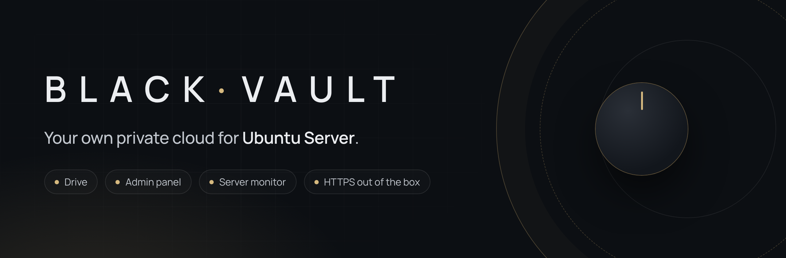
</p>

<p align="center">
  <a href="CHANGELOG.md"></a>
  
  
  
  <a href="#license"></a>
  <a href="https://github.com/bursec-official/blackvault/actions/workflows/check.yml"></a>
</p>

<p align="center">
  <b>Turn an Ubuntu Server into a private cloud for your home or small office.</b><br>
  Private drives for everyone, an admin panel and a live server monitor.<br>
  No database, no Docker, no accounts anywhere else. One command to install.
</p>

<p align="center">
  <a href="#install">Install</a> ·
  <a href="#screenshots">Screenshots</a> ·
  <a href="#features">Features</a> ·
  <a href="docs/https.md">Certificates</a> ·
  <a href="docs/troubleshooting.md">Help</a>
</p>

<br>

<p align="center">
  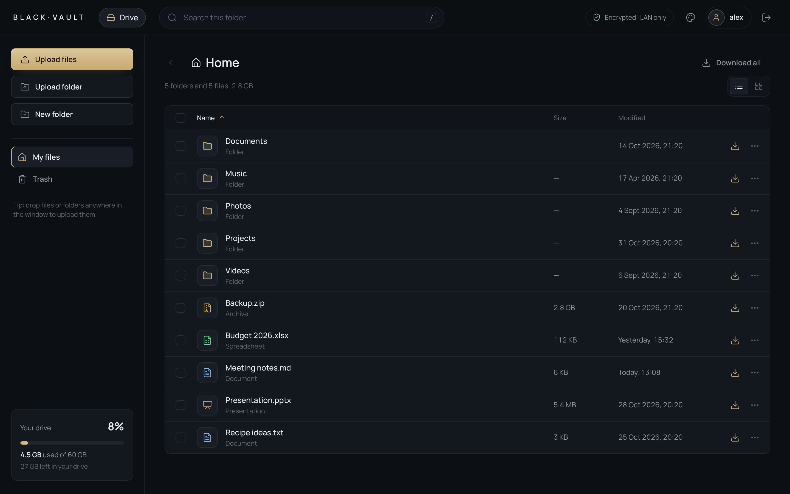
</p>

## What is it?

Black Vault is three small web apps that run on your own server:

| App | Address | Who uses it |
|---|---|---|
| **Drive** | `https://SERVER/` | Everyone with an account. Each person gets a private drive for their files. |
| **Admin panel** | `https://SERVER/admin.php` | The administrator. Add people, set storage limits, manage disks, see activity. |
| **Monitor** | `https://SERVER:8443/` | The administrator. Live CPU, memory, network, disks, temperature and processes. |

Your files never leave your server, and only devices on your own network can open it.

## Install

You need **Ubuntu Server 24.04 LTS or newer** (tested on 24.04 and 26.04) and a user with `sudo`. Any 64-bit machine works: an old PC, a mini PC, a home server. The installer adds Apache and PHP by itself.

```bash
git clone https://github.com/bursec-official/blackvault.git
cd blackvault
sudo bash install.sh
```

No `git`? Download the ZIP instead: **Code → Download ZIP** on this page, copy it to the server, then `unzip blackvault-main.zip && cd blackvault-main && sudo bash install.sh`.

The installer takes about a minute. At the end it shows a **one-time setup code**:

```text
✔ Done.

  ┌─ Finish the setup in your browser ─────────────────────────┐
     1. Open      https://192.168.1.20/
     2. Type this one-time setup code:   K7QM-4XPT-9HDW
     3. Create the administrator (and your first user).
     The code works for 24 hours. New one: sudo blackvault-admin setup-code
  └────────────────────────────────────────────────────────────┘
```

### First-time setup

Open the address in a browser on the same network. The browser warns about the certificate the first time. That is expected, because the certificate comes from your own server. Continue, and [remove the warning](docs/https.md) later.

<table>
  <tr>
    <td width="50%">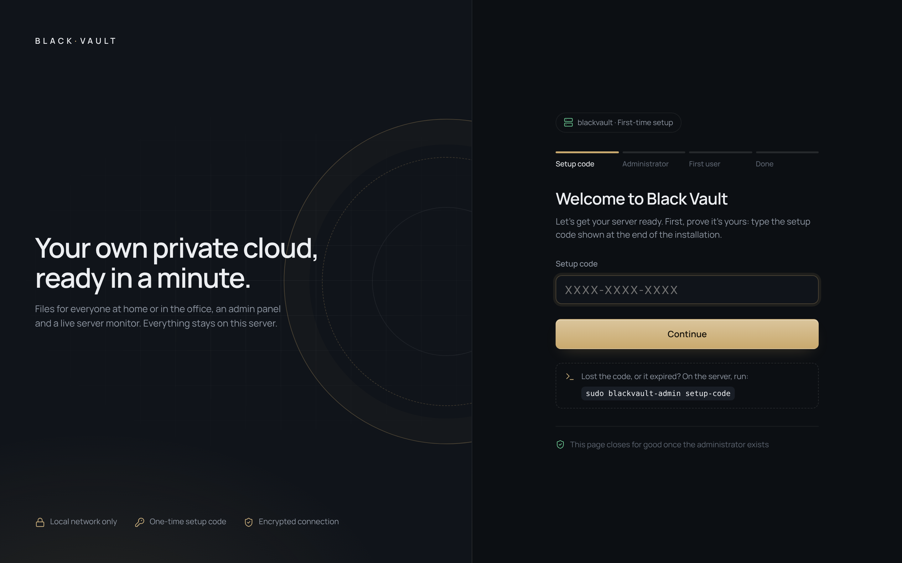</td>
    <td width="50%">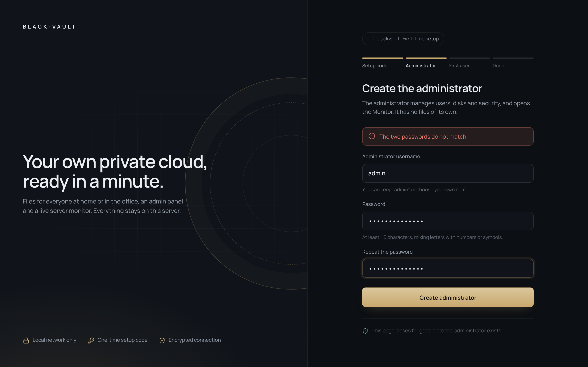</td>
  </tr>
  <tr>
    <td><b>1. Setup code.</b> Proves you own the server. Without it, nobody else on the network can take it over.</td>
    <td><b>2. Administrator.</b> The account that manages everything. The name starts as <code>admin</code>; keep it or change it.</td>
  </tr>
  <tr>
    <td>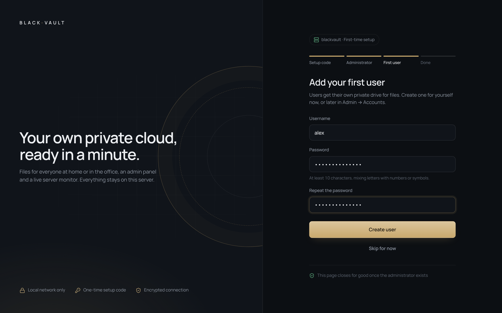</td>
    <td>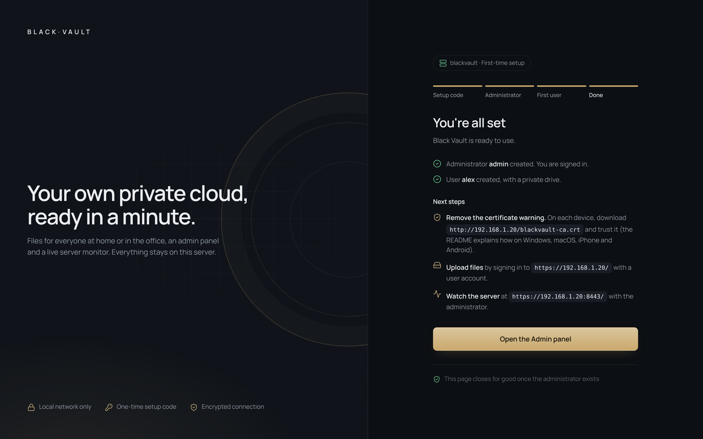</td>
  </tr>
  <tr>
    <td><b>3. First user.</b> An account with its own drive, for your files. You can skip it and add people later.</td>
    <td><b>4. Done.</b> You are signed in to the Admin panel. The setup page closes for good.</td>
  </tr>
</table>

> [!TIP]
> Give the server a **fixed IP address** (a "DHCP reservation" in your router). The address is part of the certificate, so it should not change.

### Update

Download the new version and run the installer again. Your files, accounts and settings are kept. The old code is backed up in `/var/backups/blackvault/` first.

```bash
cd blackvault
git pull
sudo bash install.sh
```

## Screenshots

<table>
  <tr>
    <td width="50%">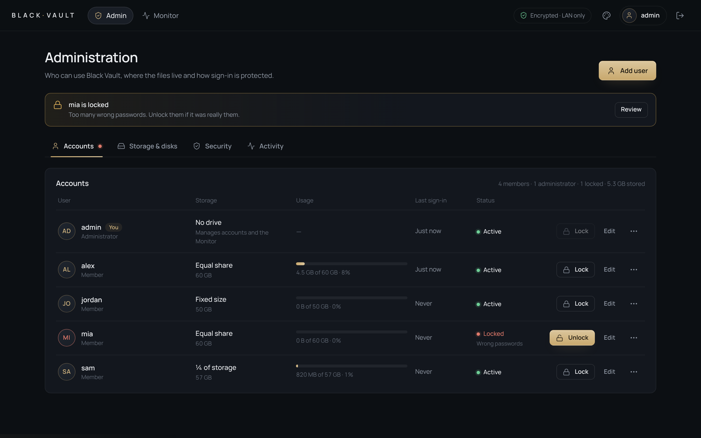</td>
    <td width="50%">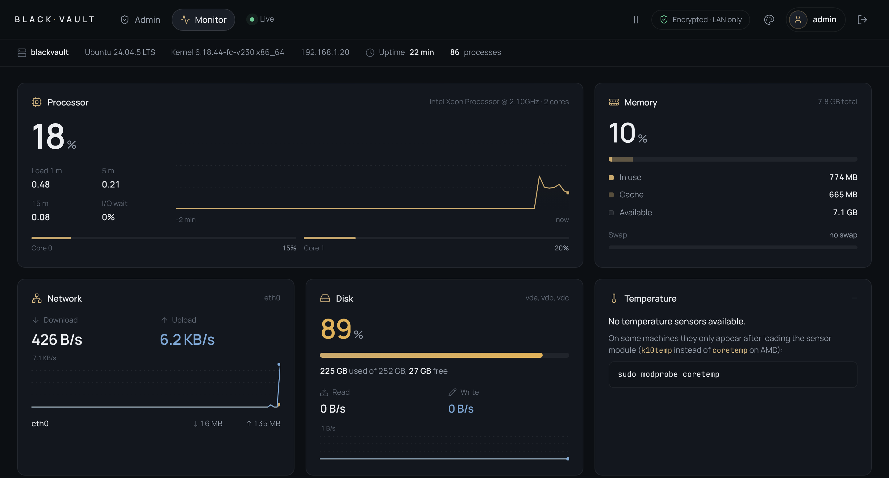</td>
  </tr>
  <tr>
    <td align="center"><b>Admin panel.</b> Accounts, storage limits, lock and unlock.</td>
    <td align="center"><b>Monitor.</b> Live CPU, memory, network and disks.</td>
  </tr>
  <tr>
    <td>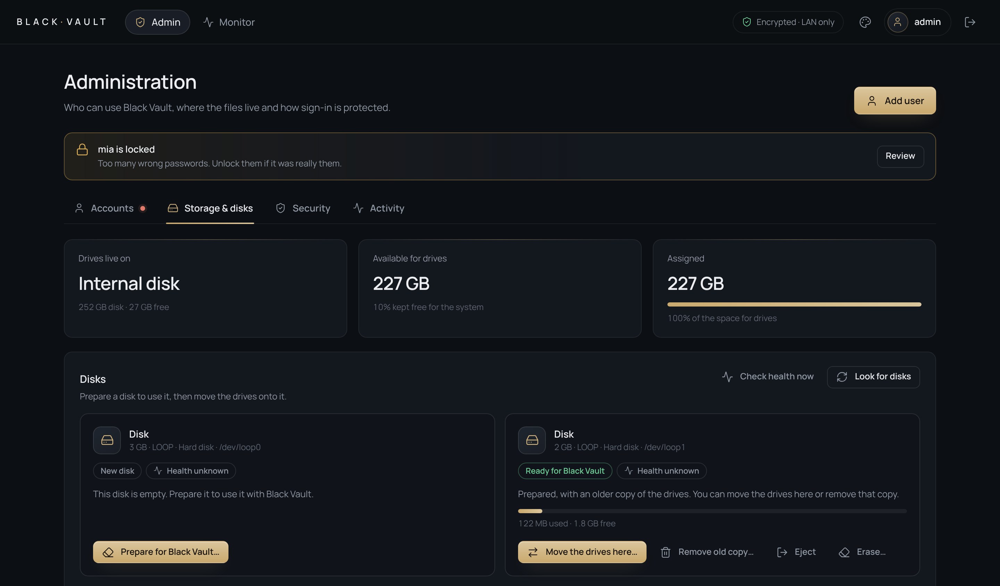</td>
    <td>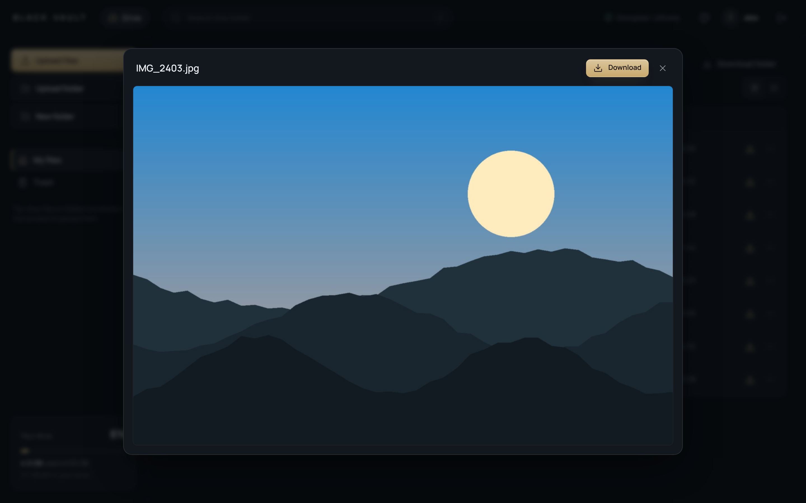</td>
  </tr>
  <tr>
    <td align="center"><b>Storage &amp; disks.</b> Plug in a disk and move the drives to it.</td>
    <td align="center"><b>Preview.</b> Photos, videos, music, PDF and text.</td>
  </tr>
  <tr>
    <td>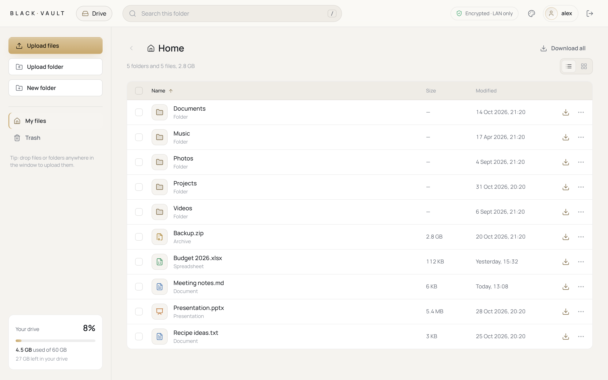</td>
    <td>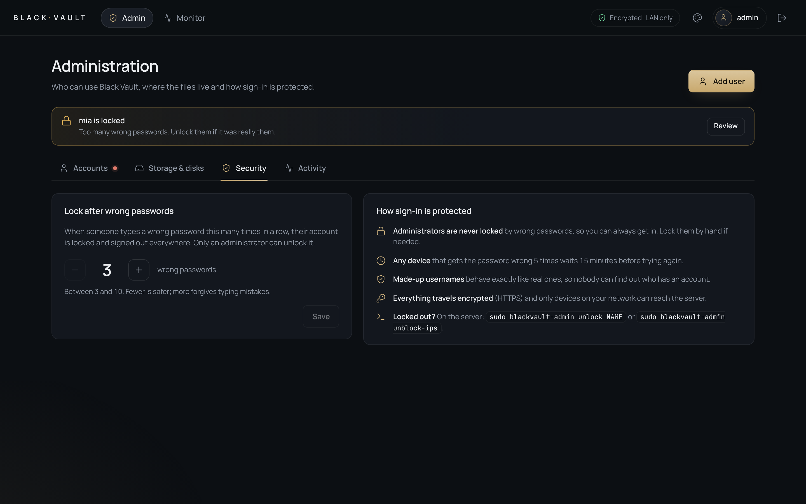</td>
  </tr>
  <tr>
    <td align="center"><b>Light theme.</b> Dark or light, with your own accent colour.</td>
    <td align="center"><b>Security.</b> Choose how many wrong passwords lock an account.</td>
  </tr>
</table>

<p align="center">
  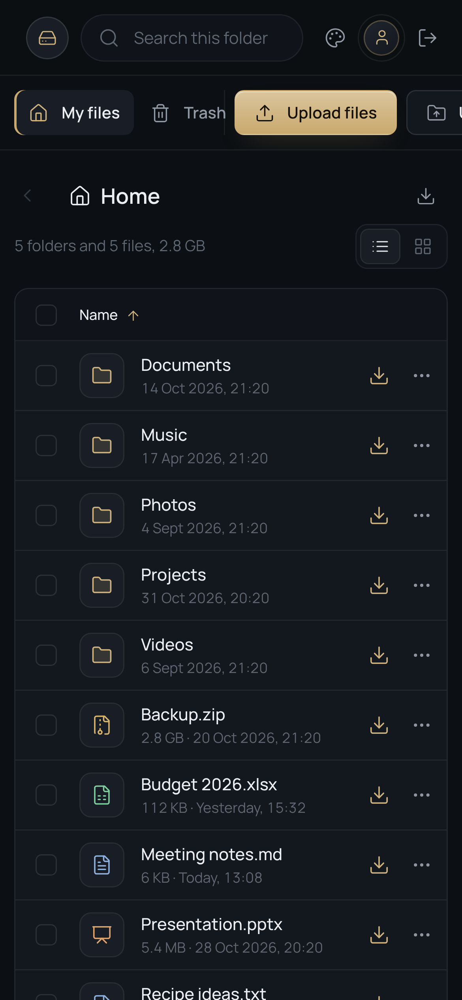
  &nbsp;&nbsp;&nbsp;
  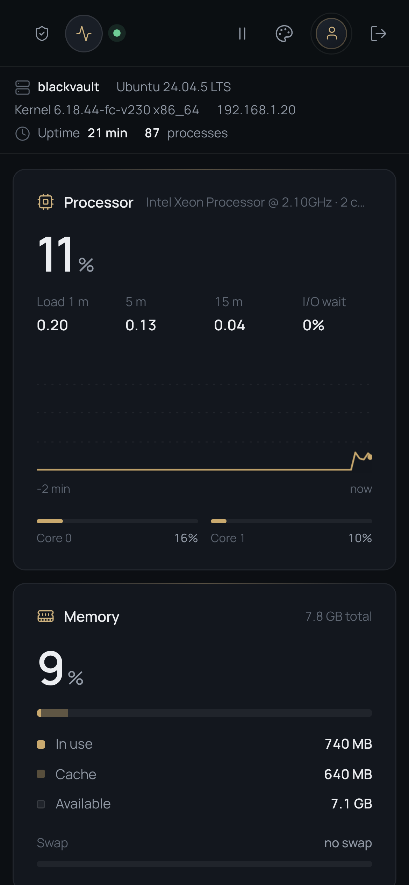
</p>
<p align="center"><b>Works on phones too.</b></p>

## Features

**Drive**
- Upload files and whole folders (button or drag and drop), up to 20 GB per file, with progress, speed and time left.
- Uploading a folder again only sends what is missing.
- Download files, folders or a selection as a ZIP. The ZIP is built while it downloads, so it needs no extra disk space.
- Preview photos, videos, music, PDF and text files.
- Move, rename, delete and multi-select. Keyboard shortcuts and search.
- **Trash** with Undo. Deleted items stay 30 days and can be restored.

**Admin panel**
- Add, edit, lock and delete accounts. Members have a private drive; administrators have none.
- Storage limits per person: equal share, part of the storage (½, ⅓…), a fixed size, or no limit.
- **Disks:** plug a USB or internal disk into the server, prepare it and move all the drives onto it from the browser, with progress. No terminal needed.
- Activity log: sign-ins, failed sign-ins and every admin change.

**Monitor**
- Live CPU (per core), memory, network, disk speed, temperature and the busiest processes.
- **Disk health** (SMART): temperature, hours on and wear, without waking sleeping disks.

## Security

Black Vault is built to be safe on a home or office network by default. The details are in [SECURITY.md](SECURITY.md).

- **HTTPS everywhere.** The installer creates a private certificate authority that can only vouch for your server. Plain `http://` only redirects.
- **Local network only.** Only private networks (and VPNs like Tailscale or WireGuard) can open it. Everyone else gets "Access denied", even if a router port is opened by mistake.
- **Locked after wrong passwords.** Members are locked after 3 wrong passwords in a row (you can choose 3–10), and only an administrator can unlock them. Every device is slowed down after 5 failures.
- **Uploaded files never run.** Any file type can be stored, but the drives are never served or executed. The installer attacks its own setup to prove this every time.
- **No root for the web.** Disk actions go through a tiny root service that accepts a short list of checked commands only.
- Strict security headers, CSRF protection, sessions that expire, and no third-party scripts.

> [!IMPORTANT]
> Do not open ports 80, 443, 8080 or 8443 on your router. To reach Black Vault from outside, use a VPN into your network, such as [Tailscale](https://tailscale.com) or WireGuard.

## Rescue console

On the server, over SSH:

```bash
sudo blackvault-admin status                 # list accounts
sudo blackvault-admin setup-code             # new code for the first-time setup page
sudo blackvault-admin create-admin           # create an administrator from the terminal
sudo blackvault-admin unlock NAME            # unlock a locked account
sudo blackvault-admin reset-password NAME    # set a new password (also unlocks)
sudo blackvault-admin unblock-ips            # clear the 15-minute sign-in brake
sudo blackvault-tls show                     # certificate fingerprint and download address
```

## Guides

- [Install and update](docs/install.md): requirements, firewall, what the installer changes.
- [Remove the certificate warning](docs/https.md): Windows, macOS, iPhone, Android, Linux, Firefox.
- [Accounts and storage limits](docs/accounts.md): members, administrators, locks.
- [Disks and disk health](docs/disks.md): add a disk and move the drives onto it.
- [Troubleshooting](docs/troubleshooting.md): common problems and fixes.
- [Uninstall](docs/uninstall.md)

## Project layout

```text
blackvault/
├── install.sh          installer and updater (run with sudo)
├── minidrive/          Drive + Admin panel  →  /var/www/minidrive
├── sysmonitor/         Monitor              →  /var/www/sysmonitor
├── tools/
│   ├── blackvault-disk   root service for disks (socket for the web server only)
│   └── blackvault-tls    certificates: create, renew, show
└── docs/               guides and screenshots
```

Plain PHP, JavaScript and CSS, with no frameworks and no build step.

## Contributing

Bug reports and ideas are welcome: open an [issue](https://github.com/bursec-official/blackvault/issues). For pull requests, see [CONTRIBUTING.md](CONTRIBUTING.md). Please report security problems privately, as explained in [SECURITY.md](SECURITY.md).

## Author

Black Vault is created, owned and maintained by **[bursec-official](https://github.com/bursec-official)**. All rights belong to the author, except the permissions given in the [LICENSE](LICENSE).

AI tools ([Claude](https://claude.ai), by Anthropic) were used as a work tool during development. That is why Claude appears among the contributors. It gives Anthropic no ownership of or rights over the project. See [NOTICE](NOTICE.md).

## License

Black Vault is **free to use for everyone**, companies included, under the [PolyForm Shield License 1.0.0](LICENSE).

- ✅ **Allowed:** use it at home, in your company, school or organisation, for your own files and your own team. Read the code, change it, share it.
- ❌ **Not allowed:** selling Black Vault or a copy of it, charging others for installing, hosting or managing it, or offering it (changed or renamed) as your own product or service, even for free.
- 📝 **Always:** keep the copyright notice and the license with every copy.

**Want to sell it, or offer it to your clients?** You need a commercial license from the author. [Ask for one here](https://github.com/bursec-official/blackvault/issues/new?template=commercial_license.yml).

Included third-party work: [Lucide](https://lucide.dev) icons (ISC), [Manrope](https://github.com/sharanda/manrope) and [JetBrains Mono](https://github.com/JetBrains/JetBrainsMono) fonts (SIL Open Font License). Their licenses are next to the files.
